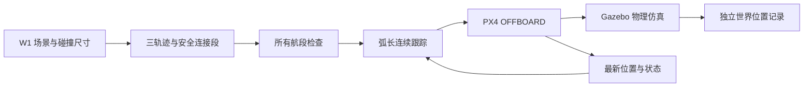
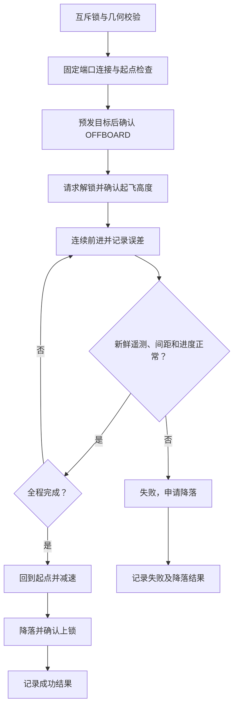

# 云端三轨迹修复

关联 Issue：GXMZU-AITECC/yundrone-sunray150#204；草稿 PR：#205。

## 功能说明：解决什么问题

用户需要在 W1 训练场中完成八字、方形、围绕四个锥桶各一周的演示。
旧实现并不是可靠的避障规划：只把航点向外推，未检查连接线；逐航点等待最长 30 秒，超时仍继续。
尤其启动脚本将飞机出生点设置为世界坐标 `(1.01, 0.98)`，而任务认为起点在世界原点。
即使规划图看起来安全，真实飞机也会相对障碍物整体偏移。

## 文件及责任

- `flight_paths.py`：场景坐标下的三种几何轨迹、连接段最短路、整段间距校验、弧长采样和弯道限速。
- `smooth_flight.py`：20 Hz MAVLink 发布，连接、起飞、连续跟踪、返航、落地确认及日志。
- `test_flight_paths.py`：重现旧版起飞对角线穿障，并验证闭合、双叶交叉和四个完整圆周。
- `sitl_run.sh`：云端原启动器的备份修改版；出生点默认改为世界原点，可通过环境变量配置。
- `verify_runs.sh`：同一个仿真实例连续运行三个任务，任何一个失败立即停止。
- `ground_truth.py`：独立读取 Gazebo 世界坐标，用于检查估计位置与场景实际位置的差异。
- `evidence/`：带时间戳的规划、遥测 CSV、结果 JSON 和日志；失败证据也保留。

仓库集成位置为 `scripts/cloud_flight/`。关键文件与文档双向关联：

| 文件 | 职责 |
| --- | --- |
| `scripts/cloud_flight/flight_paths.py` | 路径生成、线段检查、转弯提前减速 |
| `scripts/cloud_flight/smooth_flight.py` | 飞行状态机、日志和落地确认 |
| `scripts/cloud_flight/test_flight_paths.py` | 几何与刹车距离回归 |
| `scripts/cloud_flight/fly_safe.sh` | 统一任务入口，失败不自动重飞 |
| `scripts/cloud_flight/verify_runs.sh` | 三任务顺序验收 |
| `scripts/cloud_flight/ground_truth.py` | 世界坐标独立取证 |
| `scripts/cloud_flight/sitl-origin.patch` | 对云端 PX4 旧启动器应用出生点修正，不覆盖整个上游文件 |
| `.github/workflows/cloud-flight-geometry.yml` | 轻量几何回归，不冒充重型 SITL |

## 架构



## 执行流程



## 设计动机：为什么这么做

### 坐标不能混用

路径和锥桶使用世界 ENU：x 向东，y 向北，z 向上。飞控接口使用 NED：north=y、east=x、down=-z。
起飞前同时读取 Gazebo 世界位置与飞控局部位置，计算 ENU/NED 之间的平移。
只把飞控当前位置当成原点会把落点误差逐次累加，因此世界原点始终固定。
启动器默认将无人机放在世界原点；重复运行允许起点距世界原点不超过 0.65 m，先原地垂直起飞再回到任务起点。
这种读取 Gazebo 真值的校准仅适合仿真；实机必须替换为经过标定的定位来源。
启动高度保留原值，物理引擎让飞机落稳后再起飞。

### 航点安全不等于航段安全

场景四锥桶位于 `(±1.5, ±1.5)`。完整线段到每个中心的最小距离都需要达到 1.20 m。
锥桶网格单位为英寸，SDF 又放大 10 倍；不能忽略网格的单位和比例。
Iris 的机身、四个旋翼及跟踪误差均需预留空间。上述半径只用于此场景，不是任意障碍物的通用安全距离。
方形先沿空走廊到边中点，再绕外方形一周，从同一走廊返回，不直接斜穿锥桶。
八字用连续参数曲线，经过中心交叉两次形成左右双叶；不是原来互不相连的上下两组曲线。
四圈保持每个圆的半径 1.35 m，连接段使用离散可见图 Dijkstra；不把圆周航点推歪。

### 连续跟踪与速度

以弧长推进目标，位置目标加切向速度前馈，最高 0.60 m/s；向前检查 1.2 m 的曲率，并按制动距离提前减速。
跟踪误差增大时减慢目标推进，避免目标跑远；超过持续停滞时间则失败降落，不跳过航段。
20 Hz 是期望发布频率，宿主机过载仍可能降低实际频率，验证要查看日志时间间隔。
高度 0.65 m，是绕行锥桶而非飞越锥桶。任务完成后先回到起点并减速，再请求降落。

### 状态与重复运行

UDP 在本地固定绑定 14550，与 PX4 的 18570 通信，防止回复仍发往旧进程的临时端口。
每轮接收队列取最新数据，避免阻塞收包拖慢目标发布。
用互斥锁拒绝两个新版控制器同时执行；旧版控制程序也必须停止，不能同时控制飞机。
落地后必须收到新鲜的落地状态和解除武装心跳，才能报告成功。
当前云端 `COM_DISARM_LAND=-1` 关闭了自动上锁，因此确认落地后请求普通上锁；不使用强制解锁或强制停桨。

## 如何运行与验收

云端已有环境可分别执行，必须等上一项结束后再执行下一项：

```bash
bash /root/fly_figure8.sh
bash /root/fly_square.sh
bash /root/fly_circles.sh
```

没有运行仿真时先执行 `bash /root/fix_sitl_fly.sh`。任务失败会返回非零退出码，不会自动重启再盲飞。
每次启动都有独立的时间戳 CSV、规划 JSON 和结果 JSON；打印 `LANDED DISARMED` 且结果 `success=true` 才算控制流程完成。
云端完整记录位置是 `/root/autodl-tmp/flight-repair/evidence/`，原脚本保留在同目录 `backup/`。
几何测试执行 `python3 -m unittest discover -s scripts/cloud_flight -p test_flight_paths.py -v`。
新增的轻量 CI 检查六项几何回归、Python 编译、Shell 语法；它不替代既有重型流水，也不能证明真实飞行通过。

### 在相同环境复现安装

本补丁适配本次检查到的 Gazebo Classic 11 与 `Tools/sitl_run.sh` 启动方式。
不是通用于所有 PX4 版本的安装器，不适用于新版 `gz sim` 启动器。
依赖 Python 3、pymavlink（云端为 2.4.50）、Gazebo `gz model` 命令以及已编译的 PX4 SITL。

1. 先停止当前任务并确认飞机已落地上锁，备份原启动器和三个任务入口。
2. 把仓库 `scripts/cloud_flight/` 复制到云端 `/root/autodl-tmp/flight-repair/`。
3. 在 PX4 根目录检查 `git apply --check /path/to/sitl-origin.patch`，通过后再应用。已修正的环境不要重复应用。
4. 将三个 `fly_*.sh` 入口复制到 `/root/`；它们只调用持久目录下的统一入口。
5. 重启仿真后，确认世界出生点位于原点，先运行八字，再运行方形和四圈。

回滚时先确认落地，恢复 `backup/` 中的 `sitl_run.sh` 到原 PX4 目录，并恢复三个旧入口。
回滚会重新带回旧版路径缺陷，只用于问题对照，不建议继续用旧版演示。

## 真机边界与验证限制

### 最后一轮云端实测结果

同一 PX4+Gazebo 实例中依次完成八字、方形、四圈，中间没有重启仿真。
下列耗时从任务轨迹开始到回到起点，**不含连接、起飞和降落**，不能当成命令总耗时。

| 任务 | 轨迹耗时 | 最大目标跟踪误差 | 飞控记录最小锥桶中心距离 | 落地上锁 |
| --- | --- | --- | --- | --- |
| 八字 | 43.07 秒 | 0.337 m | 1.266 m | 已确认 |
| 方形 | 75.35 秒 | 0.331 m | 1.487 m | 已确认 |
| 四圈 | 100.06 秒 | 0.335 m | 1.089 m | 已确认 |

实际 CSV 最大连续记录间隔分别为 0.130、0.113、0.100 秒，没有出现旧版每航点 30 秒等待。
目标跟踪误差包含沿路径方向的滞后，不等于横向偏离曲线的误差。
四圈实测最小中心距离小于规划保留的 1.20 m，说明跟踪不是零误差；不能宣称实测全程达到规划间距。
独立 Gazebo 采样记录的最小锥桶中心距离约 1.077 m。
锥桶网格的全高度投影包络半径约 0.356 m，Iris 机身与旋翼平面包络约 0.39 m，
该采样下的保守水平间隙约 0.33 m。离散采样不是接触传感器证明，仍应保留该限制。

方形提前减速前最大目标误差约 0.545 m，调整后约 0.331 m；修正代价是轨迹耗时从约 69 秒增加至 75 秒。
这是为减少角点冲出再绕回做的取舍，不把最高速度当成唯一目标。

最终原始结果：

- `showcase/cloud_flight/figure8-20261012-162953.result.json`
- `showcase/cloud_flight/square-20261012-163103.result.json`
- `showcase/cloud_flight/circles-20261012-163238.result.json`


图中虚线是规划轨迹，实线是飞控估计轨迹；独立世界坐标原始数据另存 `world_positions.csv`。
外圈虚线表示规划中心间距，不是障碍物本体。

离线六项几何回归已经通过。第一轮八字实际飞行约 41 秒，但降落上锁确认失败，因此该轮标记失败。
最终三个任务的复测数据以各自 `.result.json` 为准；本文件不以路径规划通过冒充飞行验收通过。
Gazebo 世界坐标与飞控估计坐标应分别检查；单独一张截图不能证明全程未碰撞。
本实现是特定静态场景的仿真修复，不包括动态避障、地形建图、实机标定或硬件部署。
